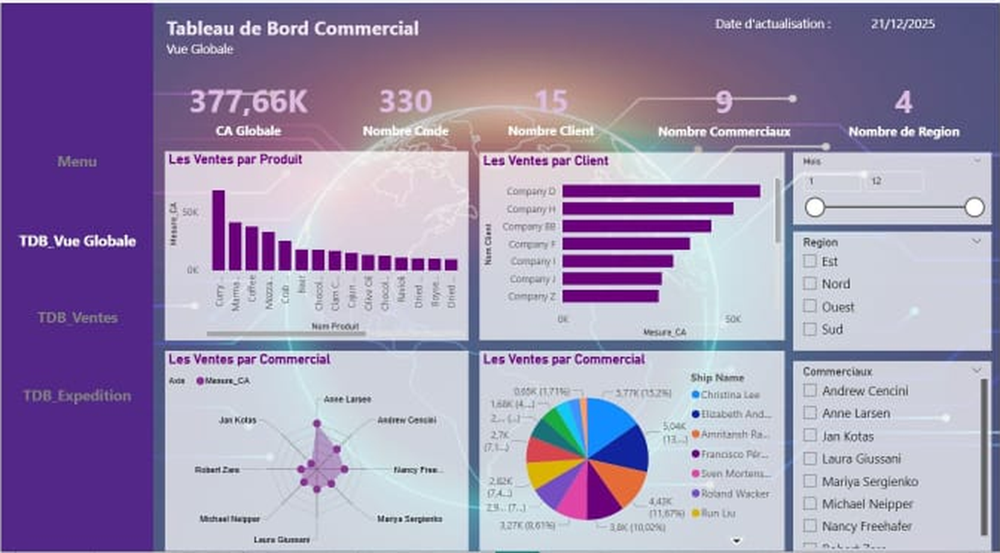
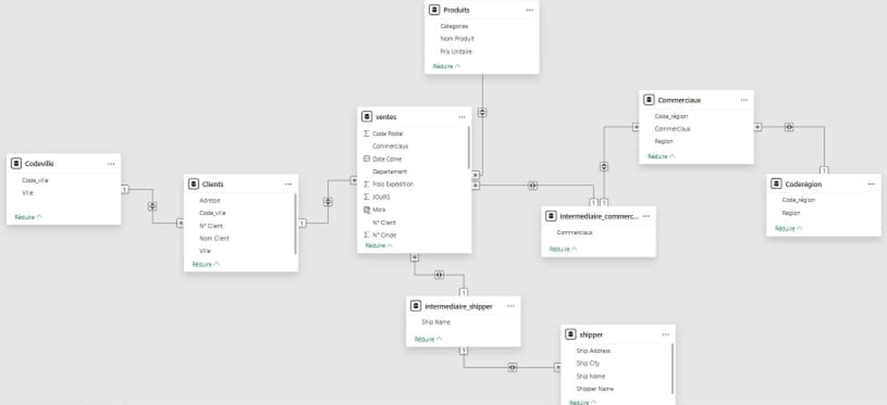
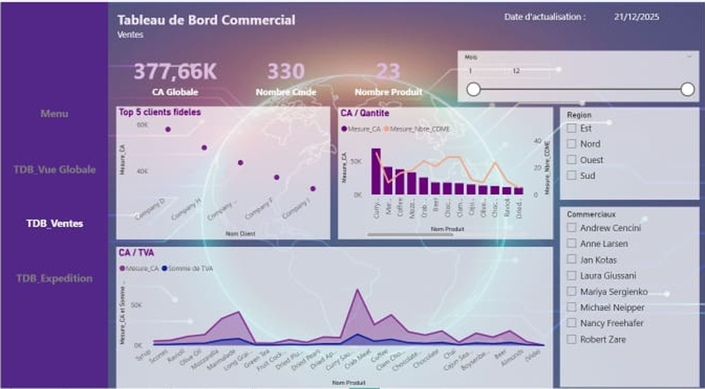
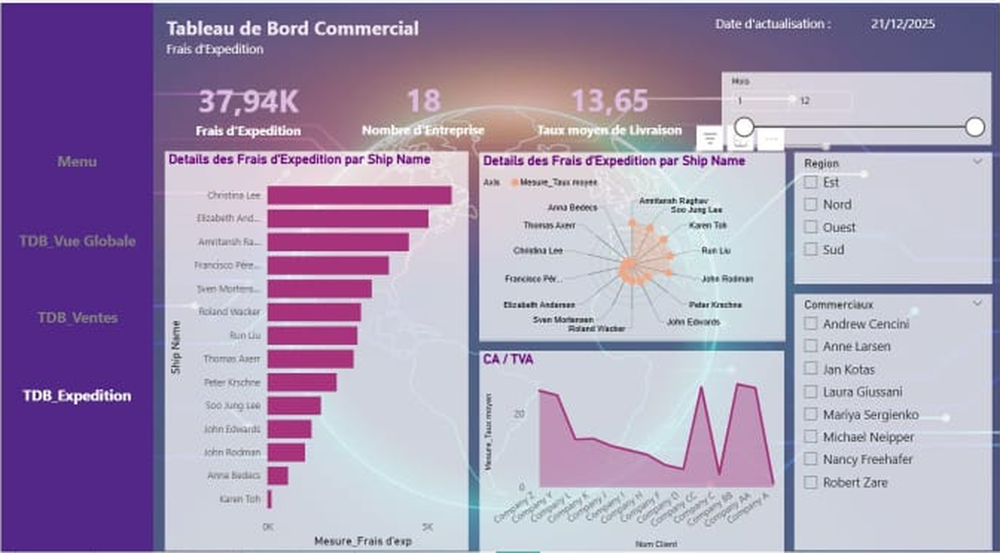

# 📊 Analyse des performances commerciales et logistiques

Tableau de bord **Power BI** : suivi des ventes, des clients, des commerciaux et des frais d'expédition, à partir d'une base relationnelle Excel.



## 🎯 Objectif
Donner une vue d'ensemble de l'activité commerciale et des coûts de livraison, avec des filtres par **mois**, **région** et **commercial**.

## 🔑 Indicateurs clés
| Indicateur | Valeur |
|---|---|
| Chiffre d'affaires global | **377,66K** |
| Nombre de commandes | **330** |
| Régions | **4** (Est, Nord, Ouest, Sud) |
| Frais d'expédition totaux | **37,94K** |
| Délai moyen de livraison | **13,65 jours** |

## 🗂️ Structure du dépôt
```
analyse-performances-commerciales-powerbi/
├── README.md
├── LICENSE
├── data/        → base Excel (7 feuilles) + dictionnaire de données
├── powerbi/     → fichier .pbix du rapport
├── images/      → captures du modèle et des 3 pages du rapport
└── docs/        → fiche portfolio (Word)
```

## 🗃️ Données
Source : [`data/Projet2_Donnees_Commercial.xlsx`](data/Projet2_Donnees_Commercial.xlsx) — 7 feuilles : `ventes` (table de faits, 330 lignes), `Clients`, `Codeville`, `Commerciaux`, `Coderégion`, `shipper`, `Produits`.
Le détail des colonnes est dans [`data/README.md`](data/README.md).

> Jeu de données **fictif**, utilisé à des fins pédagogiques.

## 🧩 Modélisation
La table de faits `ventes` est reliée aux dimensions Clients, Produits, Commerciaux et Shipper. Des tables intermédiaires (`intermediaire_commerciaux`, `intermediaire_shipper`) gèrent les relations plusieurs-à-plusieurs.



## 📑 Pages du rapport
### 1. Vue globale
Ventes par produit, par client et par commercial, avec segments interactifs (mois, région, commercial).

### 2. Ventes
Analyse de 23 produits : top 5 des clients fidèles, CA par rapport à la quantité et à la TVA.



### 3. Expédition
Frais d'expédition par livreur et par client, délai moyen de livraison.



## 💡 Principaux enseignements
- **Company D** est le premier client en chiffre d'affaires (≈ 58K), devant Company H et Company BB.
- **Christina Lee** est le livreur dont les frais d'expédition sont les plus élevés (≈ 5,8K).
- Le délai moyen de livraison est de **13,65 jours**.

## ⚠️ Limites des données
Valeurs manquantes dans `ventes` : 39 dates d'expédition, 63 types de paiement et 3 noms de produit.

## 🚀 Ouvrir le projet
1. Télécharger le dépôt (**Code → Download ZIP**).
2. Ouvrir le fichier `.pbix` du dossier `powerbi/` avec **Power BI Desktop**.
3. Si besoin, pointer la source de données vers `data/Projet2_Donnees_Commercial.xlsx` (*Transformer les données → Paramètres de la source de données*).

## 🛠️ Compétences & outils
Modélisation relationnelle · Mesures DAX · Segments interactifs et navigation · Design personnalisé
**Power BI Desktop · Power Query · DAX · Excel**
